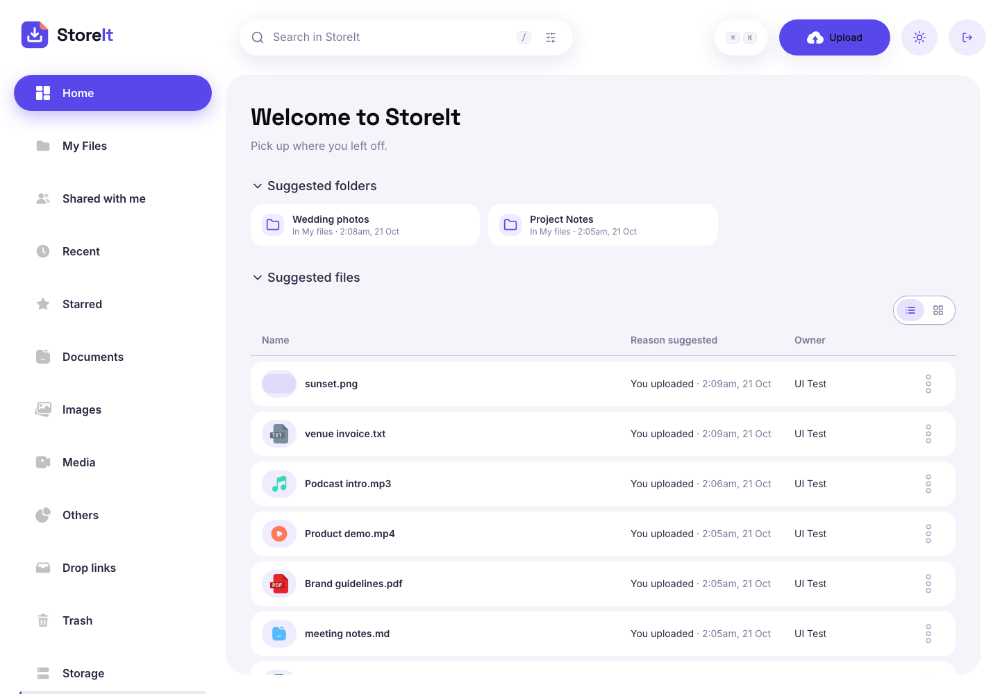
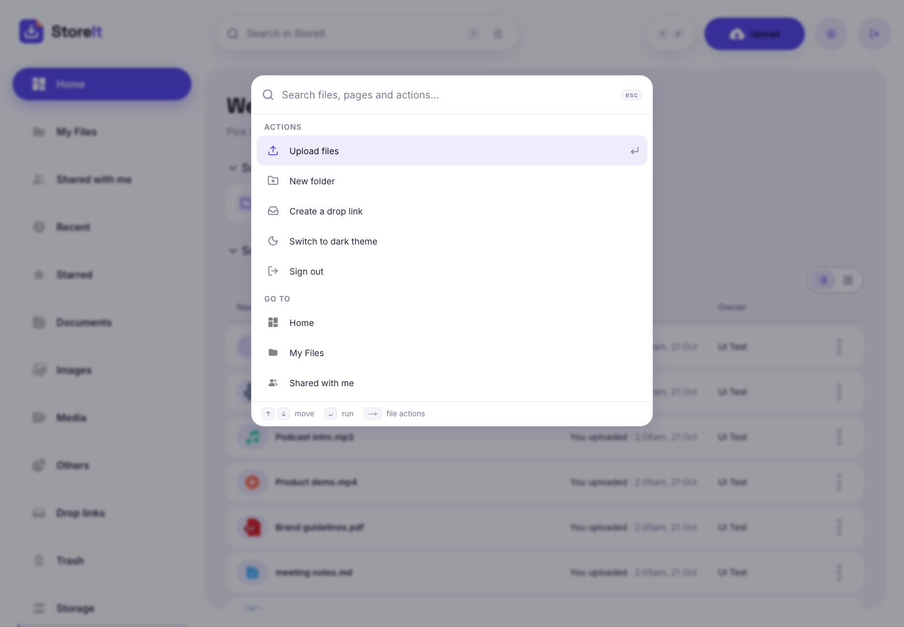
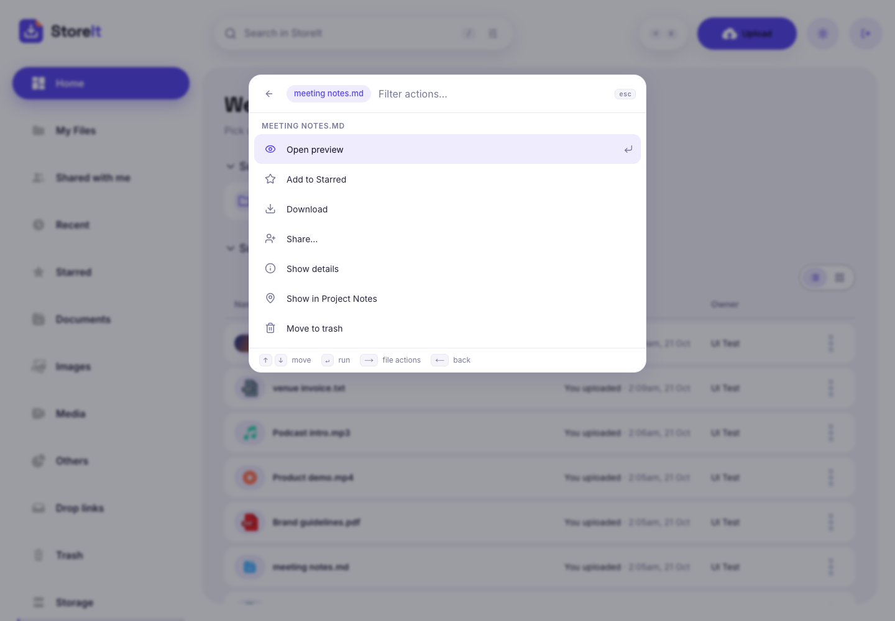
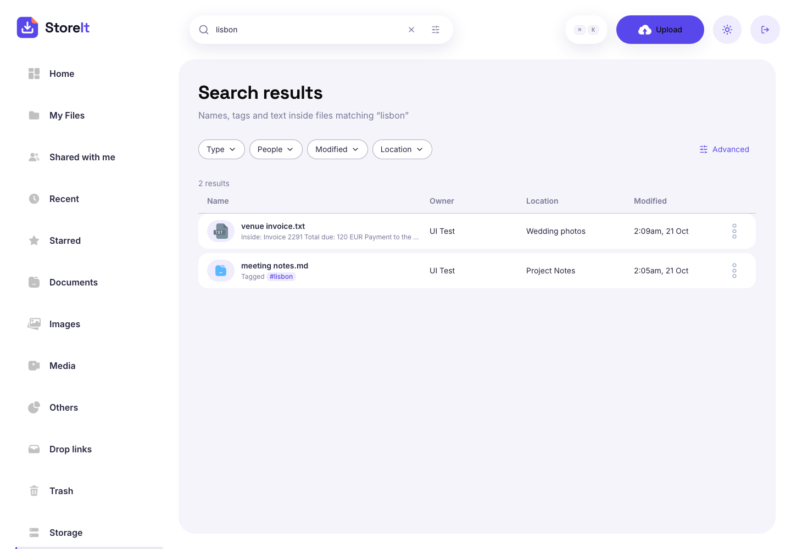
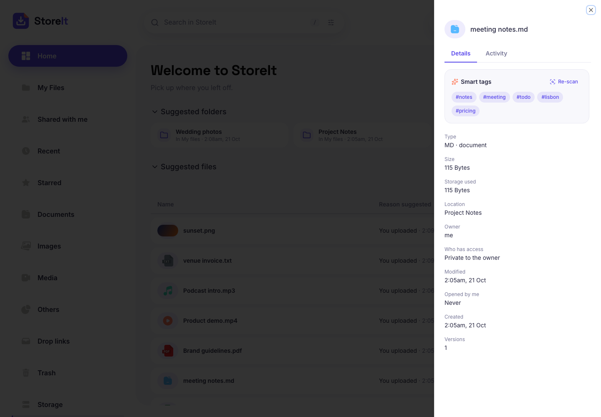
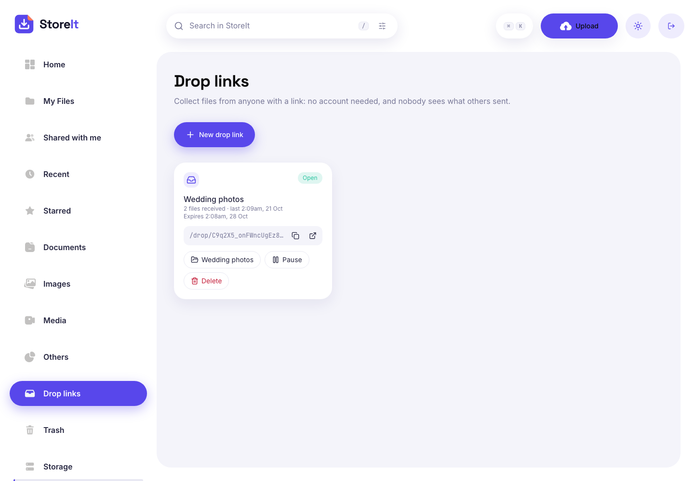
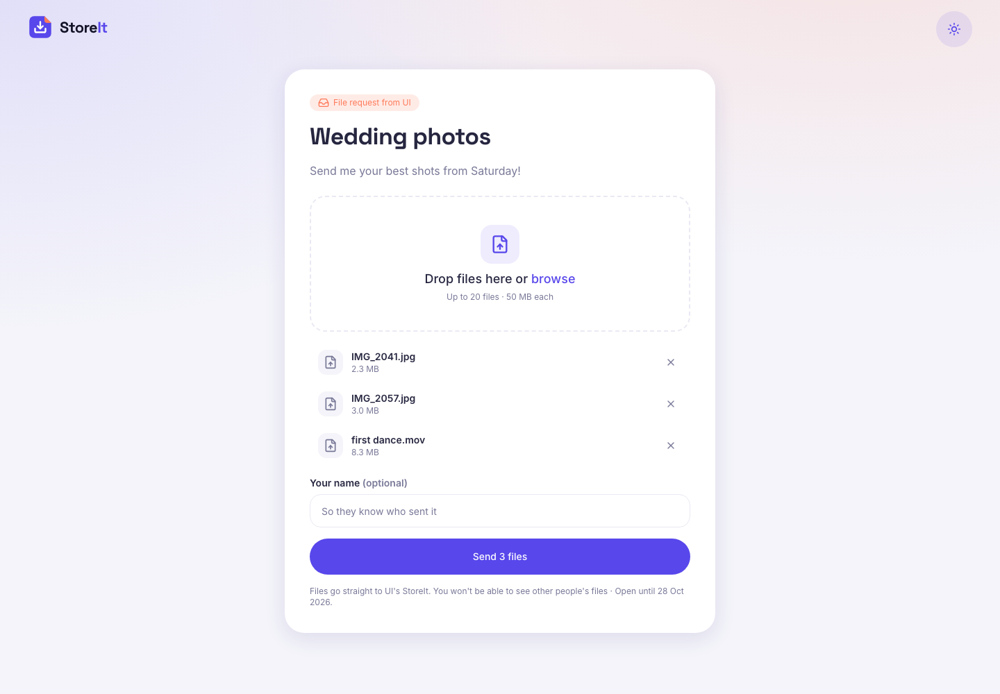
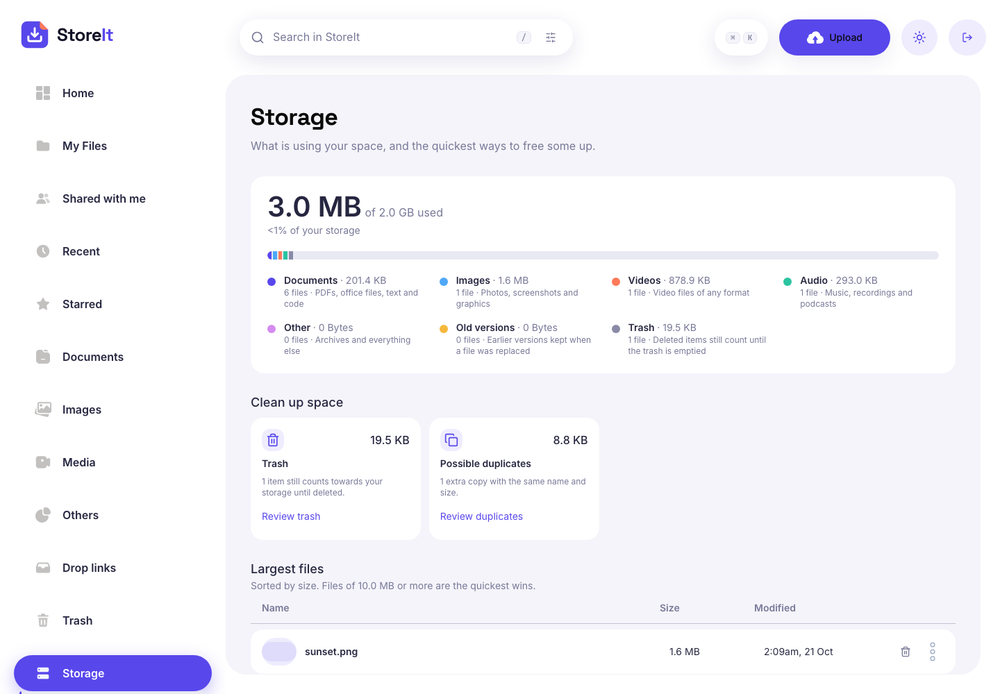
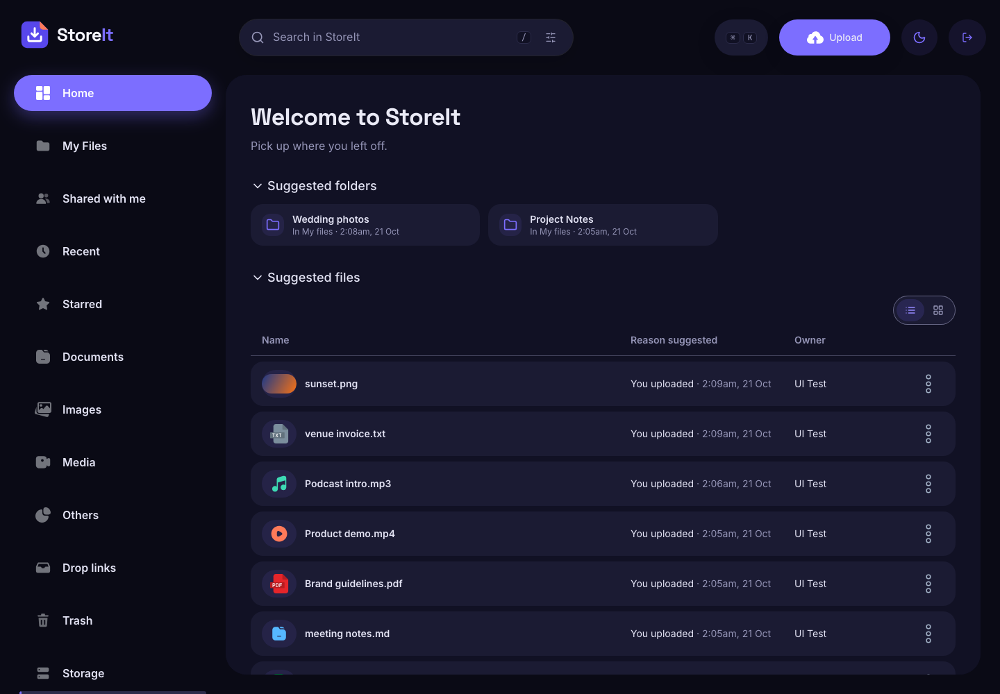

<div align="center">


# StoreIt

**Your files, sorted.** A cloud drive built with Next.js 15 and Appwrite, with fast search, drop links that collect files from anyone, and smart tags that work out what's inside each file.



</div>

## Highlights

| | |
|---|---|
| **⌘K command palette** | One keyboard-first bar for every file, page and action, including actions on a single file. |
| **Drop links** | A public page where anyone, signed in or not, can send you files. They land in your folder and the sender never sees anyone else's uploads. |
| **Smart tags and search inside files** | Each upload is tagged in the browser (invoice, meeting, screenshot, landscape, dominant colour…), and its text is indexed, so you can search for words inside your documents. No external AI API is used. |
| **Drive-level search** | Filter chips for type, people, modified date and location, recent searches, and full keyboard navigation of results. |
| **Storage insights** | A breakdown by type, the largest files, duplicates, old versions and trash, each with a one-click cleanup. |
| **Its own identity** | Indigo and Ember palette, Space Grotesk and Inter type, a custom logo, a dark theme with a circular reveal transition, and motion that respects reduced-motion settings. |

## Screenshots

<table>
  <tr>
    <td width="50%"><br/><sub><b>⌘K palette:</b> actions, pages and files in one place</sub></td>
    <td width="50%"><br/><sub>Press <kbd>→</kbd> on a file to act on it without the mouse</sub></td>
  </tr>
  <tr>
    <td><br/><sub><b>Search</b> matches names, tags and text inside files</sub></td>
    <td><br/><sub><b>Smart tags</b> in the details panel; each tag is a search link</sub></td>
  </tr>
  <tr>
    <td><br/><sub><b>Drop links:</b> create, pause, copy and track</sub></td>
    <td><br/><sub>The public page a sender sees, with no sign-in</sub></td>
  </tr>
  <tr>
    <td><br/><sub><b>Storage:</b> what's using space and how to free it</sub></td>
    <td><br/><sub><b>Dark theme</b>, switched with a circular view transition</sub></td>
  </tr>
</table>

## Features

**Files and folders**
- Nested folders, drag-and-drop upload of whole folders, and list or grid views.
- A collapsible folder tree in the sidebar that remembers what you opened.
- Filter any folder by type, modified date and sharing; shared items are marked in the list.
- Make a copy of any file, and download folders or several items at once as a ZIP built in the browser.
- Uploads go straight from the browser to storage in 5 MiB chunks, with progress, cancel, retry, resume after going offline, and name-clash handling.
- Preview images, video, audio and PDFs in place.
- Star files; Recent and Starred views.
- Trash with restore, plus undo toasts for trash, star and move.
- Version history: upload a new version, browse and restore old ones.
- An activity log per file and folder.

**Sharing**
- Share with people as viewer or editor, or transfer ownership.
- "Anyone with the link" public pages that can be turned off at any time.
- A "Shared with me" view.

**Home, search and storage**
- Home suggests the folders and files you are most likely to want next, with the reason for each.
- Search supports type, people, date and location filters, recent searches, keyboard navigation and highlighted matches.
- Storage page with a usage breakdown, cleanup cards (large files, duplicates, old versions, trash) and lists of the largest files.
- Loading skeletons on every data view.

**Signature features**
- **⌘K / Ctrl K palette:** fuzzy search across actions, pages and live file results; per-file actions (preview, star, download, share, details, show location, trash); full ARIA combobox semantics.
- **Drop links:**
  - every link gets its own Appwrite Auth user that can only upload, so senders never hold the owner's credentials;
  - finished uploads are re-permissioned to the owner and filed into a folder named after the link;
  - each link can expire, be paused, cap the number of files, and checks the owner's storage quota.
- **Smart tags:** text files get topic, keyword, email, link and money tags, and their first 10,000 characters are stored for search. Images get orientation, screenshot or photo, brightness, resolution and dominant-colour tags (from a 48 px canvas sample). Analysis runs in the browser alongside the upload, never blocks it, and can be re-run from the details panel.

## Tech stack

- **App:** Next.js 15 (App Router, Server Actions, Turbopack), React 19, TypeScript
- **Backend:** Appwrite (Databases, Storage, Auth users for upload JWTs) via `node-appwrite`
- **UI:** Tailwind CSS with theme tokens as CSS variables, shadcn/ui and Radix, lucide icons, sonner toasts, next-themes
- **Auth:** email one-time code with a signed session cookie (`jsonwebtoken`); emails sent with Resend

## Architecture notes

- **No proxying of file bytes.** The server mints a 15-minute Appwrite JWT; the browser uploads chunks directly with `XMLHttpRequest` (for progress and abort). A server action then checks ownership and completeness and creates the file document.
- **Permissions are enforced on the server.** Every action resolves the caller's role (owner, editor, viewer) before it touches a document. Clients only receive sanitised file objects; extracted text is never sent back to the browser.
- **Theme tokens.** Colours are RGB channels in CSS variables (`rgb(var(--brand) / <alpha-value>)`), so one class works in both themes.
- **Free-tier friendly.** Files are capped at 50 MB and storage at 2 GB per user, matching Appwrite's Free plan.

## Getting started

1. Install dependencies with `npm install`. Node 24 is required.
2. Create `.env.local` with these variables:
   ```
   NEXT_PUBLIC_APPWRITE_ENDPOINT=
   NEXT_PUBLIC_APPWRITE_PROJECT_ID=
   NEXT_PUBLIC_APPWRITE_DATABASE=
   NEXT_PUBLIC_APPWRITE_USERS_COLLECTION=
   NEXT_PUBLIC_APPWRITE_FILES_COLLECTION=
   NEXT_PUBLIC_APPWRITE_FOLDERS_COLLECTION=
   NEXT_PUBLIC_APPWRITE_BUCKET=
   APPWRITE_KEY=        # server API key
   JWT_SECRET=          # signs the session cookie
   RESEND_API_KEY=      # sign-in and share emails
   ```
3. Create the Appwrite schema. Every script is safe to re-run.
   ```bash
   bun scripts/setup-appwrite.ts
   bun scripts/setup-folders.ts
   bun scripts/setup-sharing.ts && bun scripts/migrate-sharing.ts
   bun scripts/setup-lifecycle.ts
   bun scripts/setup-smart.ts
   bun scripts/setup-drops.ts
   ```
4. Run `npm run dev` and open http://localhost:3000.

Optional: `bun scripts/deploy-cleanup.ts` deploys a daily Appwrite Function that empties old trash. The API key needs the `functions.read` and `functions.write` scopes.

## Project layout

```
src/app/(root)/         signed-in pages: home, files, search, storage, drops, trash…
src/app/drop/[code]/    public drop page
src/app/s/[token]/      public shared-link page
src/components/         browser, search, palette, drops, smart, storage, brand…
src/lib/appwrite/actions/  server actions (upload, sharing, lifecycle, drops, smart tags)
src/lib/smart/          in-browser file analysis
scripts/                Appwrite schema setup
```

## License

MIT. See [LICENSE](LICENSE).
